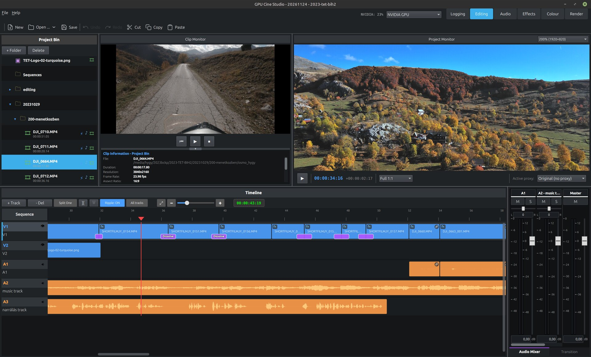
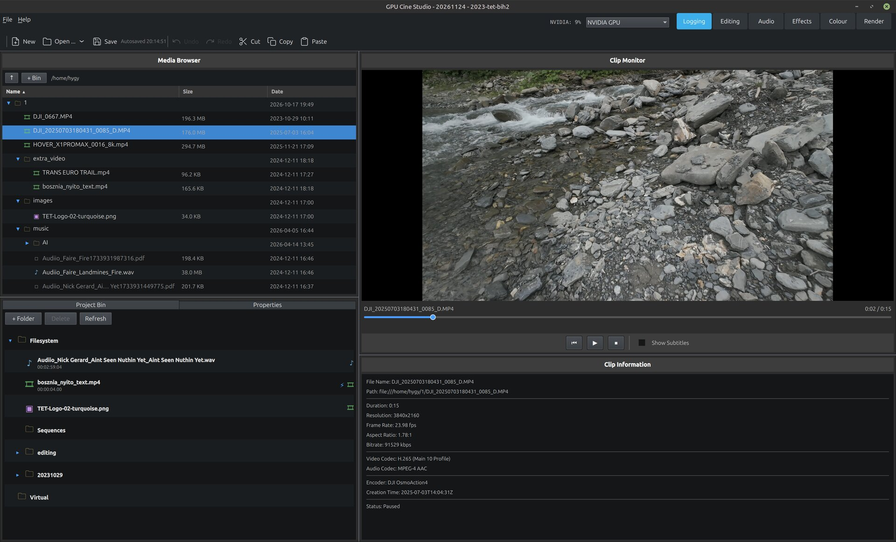
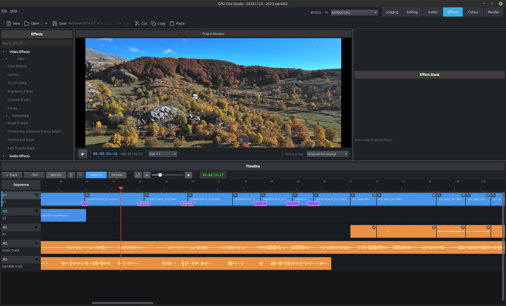
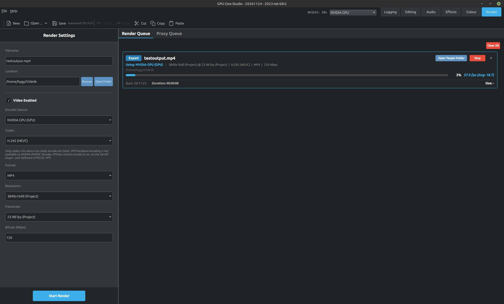

# GPU Cine Studio

A non-linear video editor for Linux, built on GStreamer / GStreamer Editing
Services (GES) with a Qt 6 / QML user interface. The timeline preview is
composited on the GPU (OpenGL) and decoding/encoding use the GPU's hardware
codecs where available.



| Logging | Effects | Render |
|---|---|---|
|  |  |  |

## Status

**Early preview / alpha.** Expect bugs and project-format changes.

- Linux only (X11 or Wayland).
- Developed and tested on NVIDIA GPUs (NVDEC/NVENC/CUDA). VA-API (Intel/AMD)
  code paths exist but are largely untested.
- Runs on GStreamer 1.28.8 with a small patch to GES (see
  [patches/](patches/README.md)); the build script below builds that version
  for you, without touching the system GStreamer.

## Features

- Project bin with folders, media metadata, clip monitor
- Multi-track timeline (video + audio tracks, linked A/V clips, track
  mute/solo/hide), snapping, zoom
- Editing: trim, split (one track or all tracks), ripple mode, delete
- Keyboard-driven editing on an "active track" (select/split/trim at the
  playhead, cut-to-cut navigation); all shortcuts are configurable
- Transitions: dissolve and SMPTE wipes, adjustable length
- Title clips
- Clip effects with keyframes: colour balance, gamma, curves and 3D LUT
  (GPU shaders), brightness/contrast and chroma key (frei0r), image overlay,
  position/zoom, fade to/from black, volume
- Audio mixer with per-track volume/pan and level meters, audio scrubbing,
  waveforms
- Proxy generation and proxy/original switching
- Hardware-accelerated render (NVENC, VA-API) with software fallback (x264,
  VP9, ...) to MP4/MOV/MKV/WebM
- Kdenlive project import (a subset: clips, tracks, common transitions and
  effects; unsupported items are listed in the import dialog)
- Undo/redo, autosave with crash recovery

## Known limitations

- No clip speed change, reverse playback or J/K/L shuttle.
- The AppImage contains no patent-encumbered software codecs; H.264/H.265
  software decoding and AAC audio need your distribution's codec packages
  (see [Codecs](#codecs)).
- Wayland: on Wayland desktops the app runs as a native Wayland client. It
  falls back to XWayland (the `xcb` Qt platform) automatically if the
  GStreamer `qml6` plugin was built without Wayland support. To force X11
  set `GCS_FORCE_X11=1` (or `QT_QPA_PLATFORM=xcb`), or tick Settings >
  Playback > "Force X11 (XWayland)" (takes effect after a restart). Native
  Wayland has been tested in a nested Weston compositor only; it is not yet
  verified on real hardware, in particular with the NVIDIA driver on a
  Wayland session.
- No track locking yet (the lock flag is stored but not enforced).
- Brightness/contrast and chroma key need the host's `frei0r-plugins`.

## Requirements

- Linux x86_64 with X11 or Wayland and OpenGL
- Qt 6.4+ (Quick, Quick Controls 2, Multimedia, DBus)
- GStreamer 1.28.8 with the GES patch from `patches/` (built by
  `scripts/build-gstreamer.sh`)
- Optional: NVIDIA driver (NVDEC/NVENC), VA-API driver, `frei0r-plugins`

## Building (Ubuntu 24.04 / Linux Mint 22)

1. Build dependencies:

   ```bash
   sudo apt install git build-essential cmake pkg-config ninja-build flex bison nasm \
       python3 pipx libglib2.0-dev libxml2-dev libgudev-1.0-dev libunwind-dev libdw-dev \
       libx11-dev libxext-dev libxv-dev libxi-dev libxrandr-dev libxdamage-dev libxfixes-dev \
       libx11-xcb-dev libgl-dev libegl-dev libgles-dev libgbm-dev libdrm-dev libwayland-dev \
       wayland-protocols libxkbcommon-dev libva-dev libvulkan-dev libpulse-dev libasound2-dev \
       libcairo2-dev libpango1.0-dev libgdk-pixbuf-2.0-dev libjpeg-dev libpng-dev libwebp-dev \
       libsoup-3.0-dev libcurl4-openssl-dev libbz2-dev zlib1g-dev libmpg123-dev \
       qt6-base-dev qt6-base-private-dev qt6-declarative-dev qt6-declarative-private-dev \
       qt6-shadertools-dev qt6-tools-dev-tools qt6-multimedia-dev qt6-wayland-dev \
       qml6-module-qtquick qml6-module-qtquick-controls qml6-module-qtquick-dialogs \
       qml6-module-qtquick-layouts qml6-module-qtquick-templates qml6-module-qtquick-window \
       qml6-module-qtqml-models qml6-module-qtqml-workerscript \
       qml6-module-qt-labs-folderlistmodel qml6-module-qt-labs-platform \
       frei0r-plugins
   pipx install meson     # GStreamer 1.28 needs meson >= 1.4; Ubuntu 24.04 ships 1.3
   ```

   Optional (otherwise meson downloads and builds them as subprojects):
   `libopus-dev libogg-dev libvorbis-dev libflac-dev libmp3lame-dev libvpx-dev
   libssl-dev libjson-glib-dev`.

2. GStreamer 1.28.8 + the GES patch, into `./gstreamer/install`
   (a few minutes on a fast machine; the system GStreamer is not touched):

   ```bash
   scripts/build-gstreamer.sh                    # --help for options
   scripts/build-gstreamer.sh --enable-patented  # also x264/x265/libav/fdk-aac/openh264
   ```

3. The app, against that GStreamer:

   ```bash
   ./build.sh
   ```

   (`build.sh` uses `./gstreamer/install` when it exists; `GCS_GST_PREFIX=...`
   picks another prefix, `GCS_GST_PREFIX=` with an empty value the GStreamer
   `pkg-config` finds.) The version is the build date (YYYYMMDD); pass
   `-DBUILD_VERSION=...` to CMake for a fixed one.

4. Run it:

   ```bash
   ./run_new_gstreamer.sh
   ```

   `GCS_GST_PREFIX` and `GCS_BUILD_DIR` override the GStreamer prefix and the
   build directory. `GCS_GL_TIMELINE=0` turns the GPU (GL) timeline mode off.

## AppImage

```bash
./build_appimage.sh [VERSION]
```

Bundles the app, Qt and the GStreamer prefix from step 2 (including the
patched GES) into `build-appimage/gpu-cine-studio-VERSION-x86_64.AppImage`.
GPU driver libraries (libGL, libEGL, libcuda, libva, ...) always come from the
host. Patent-encumbered software codecs are never bundled, even from a prefix
built with `--enable-patented` - the AppImage uses the host's instead (see
[Codecs](#codecs)).

## Codecs

The app contains no codec implementations of its own; everything goes through
GStreamer plugins, with GPU decoders/encoders (NVDEC/NVENC, VA-API) preferred.

**AppImage.** The AppImage bundles GStreamer 1.28 with all the patent-free
plugins (VP8/VP9, Opus, Vorbis, FLAC, MJPEG, ...) and the GPU codec plugins,
but not the patent-encumbered software codecs: gst-libav (FFmpeg), x264, x265,
OpenH264, fdk-aac and faad. For those it loads your distribution's own plugin
files - exactly this whitelist and nothing else of the host's GStreamer
(`libgstlibav.so`, `libgstx264.so`, `libgstx265.so`, `libgstopenh264.so`,
`libgstfdkaac.so`, `libgstfaad.so`, `libgstlame.so`, looked up in
`/usr/lib/x86_64-linux-gnu/gstreamer-1.0`, `/usr/lib64/gstreamer-1.0` and
`/usr/lib/gstreamer-1.0`; symlinked into
`~/.cache/gpu-cine-studio/host-gst-plugins/<fingerprint>`). The codec libraries those plugins
use (libavcodec, libx264, ...) come from the host as well, so the
distribution's FFmpeg version does not matter. Where the host codec libraries
need a library the AppImage also bundles (e.g. libmpg123), the host's copy is
used when it is at least as new as the bundled one; GStreamer and GLib
themselves always come from the bundle.

What needs them:

| Feature | Needs |
|---|---|
| H.264/H.265 playback | GPU decoder, or a software decoder (gst-libav, OpenH264) for files the GPU can't decode (4:2:2, 10-bit H.264, ...) and for machines without one |
| AAC audio playback (most MP4/MOV files) | gst-libav, faad or fdk-aac |
| MP4/MOV render | an H.264/H.265 encoder (NVENC/VA-API or x264/OpenH264) and an AAC encoder (gst-libav or fdk-aac) |
| Proxy generation | an H.264 encoder (GPU or software); without an AAC encoder proxy audio is stored as PCM |

MKV/WebM renders (Opus audio) work without any host codecs.

The app checks this at startup and shows what is missing together with the
install command for your distribution; **File > Settings > Codecs** shows the
same status and has a *Re-check* button (no restart needed after installing).

| Distribution | Command |
|---|---|
| Ubuntu, Debian, Linux Mint | `sudo apt install gstreamer1.0-libav gstreamer1.0-plugins-ugly` |
| Fedora | `sudo dnf install https://mirrors.rpmfusion.org/free/fedora/rpmfusion-free-release-$(rpm -E %fedora).noarch.rpm && sudo dnf swap ffmpeg-free ffmpeg --allowerasing && sudo dnf install gstreamer1-plugin-libav gstreamer1-plugins-ugly` |
| Arch, Manjaro, EndeavourOS | `sudo pacman -S gst-libav gst-plugins-ugly` |
| openSUSE | `sudo zypper install opi && opi codecs` (Packman) |

Fedora's own `ffmpeg-free` has no H.264/H.265, so `gstreamer1-plugin-libav`
alone only gives AAC; the full FFmpeg comes from RPM Fusion. OpenH264
(`gstreamer1-plugin-openh264`, Cisco's repository) gives software H.264 decode
too.

A host plugin built for a *newer* GStreamer than the bundled 1.28 cannot be
loaded (GStreamer refuses it); the codec check reports it as "installed but
incompatible" - a newer AppImage is needed then. `GCS_NO_HOST_CODECS=1`
starts the AppImage with its bundled plugins only.

**Built from source.** The app uses whatever the GStreamer it runs against
provides: `scripts/build-gstreamer.sh --enable-patented` builds the codecs into
`./gstreamer/install`; a build against the system GStreamer uses the
distribution packages above.

## Tests

UI end-to-end tests drive the real app through AT-SPI and an opt-in local test
API; see [tests/README.md](tests/README.md).

## License

GPU Cine Studio is free software, licensed under the GNU General Public
License, version 3 or (at your option) any later version
(**GPL-3.0-or-later**); see [LICENSE](LICENSE).

Copyright (C) 2025-2026 hygy

The app runs on a patched GStreamer Editing Services library, which is
licensed under the LGPL-2.1-or-later like the rest of GStreamer; the patch is
in [patches/](patches/).
